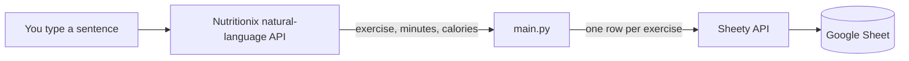

# Workout Tracker

A command-line tool that logs workouts from a plain-English description. Type something like *"ran 5k and did 30 minutes of yoga"*, and it works out each exercise, its duration and the calories burned, then adds a row for each to a Google Sheet.


## How it works



1. The sentence is sent to the **Nutritionix** exercise endpoint, which parses it with natural language processing.
2. Each recognised exercise is posted to **Sheety**, which turns a Google Sheet into a REST API, together with the current date and time.

## Features

- Logs several exercises from a single sentence.
- Credentials come from environment variables, never from the source code.
- Checks the configuration on start-up and reports any missing variable.
- HTTP errors and timeouts are surfaced instead of being silently ignored.

## Setup

1. Get an app ID and API key from [Nutritionix](https://developer.nutritionix.com/).
2. Create a Google Sheet with the columns **Date, Time, Exercise, Duration, Calories**, connect it to [Sheety](https://sheety.co/), and enable POST with Bearer authentication.
3. Install and configure:
   ```bash
   git clone https://github.com/Amin-nekouei/Workout_Tracker.git
   cd Workout_Tracker
   pip install -r requirements.txt
   cp .env.example .env      # then fill in your values
   export $(cat .env | xargs) # Windows PowerShell: set each variable with $env:NAME="value"
   ```
4. Run it:
   ```bash
   python main.py
   ```

## Example run (values are illustrative)

```
Tell me which exercises you did: ran 5k and cycled for 20 minutes
Logged running: 30.2 min, 316.5 kcal
Logged cycling: 20 min, 160.1 kcal
```

## Author

**Amin Nekouei** · [LinkedIn](https://www.linkedin.com/in/amin-nekouei) · [GitHub](https://github.com/Amin-nekouei)
